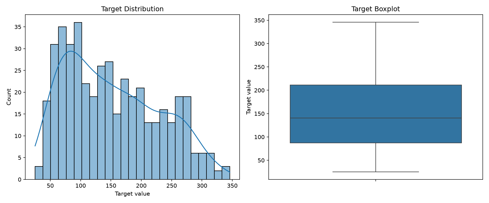
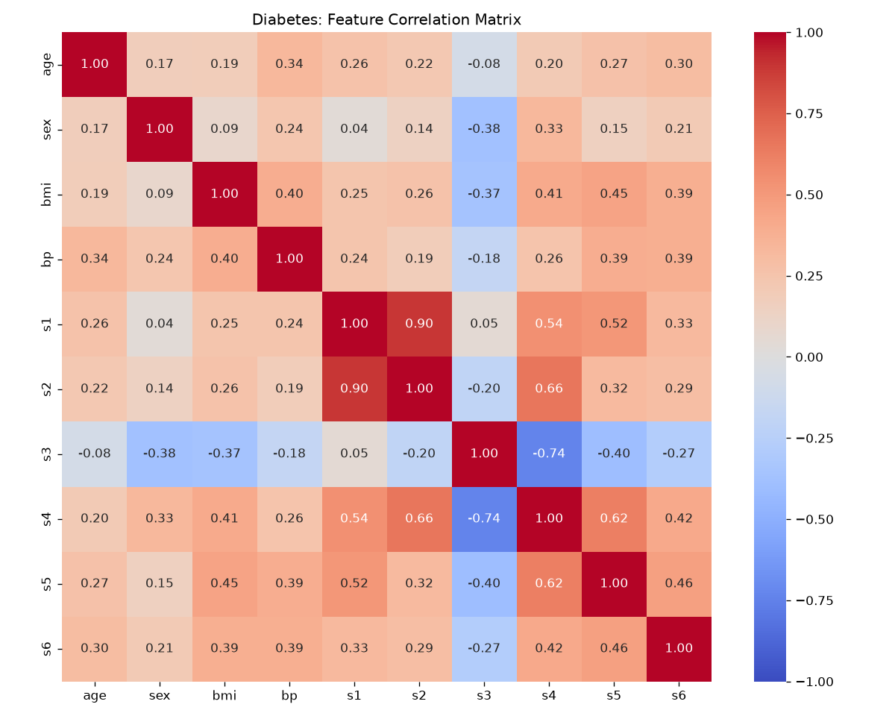
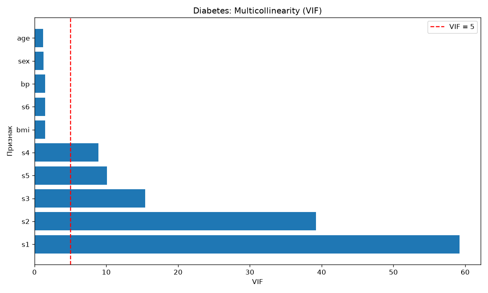

# Отчёт по лабораторной работе №1

**Вариант:** 05 — Diabetes: мультиколлинеарность
**Работа:** №1. Git-окружение, прекоммитные проверки и EDA варианта
**Дата:** 29.10.2026
**Автор:** Дарья Митцева
**Хеш коммита кода:** будет указан после итогового коммита
**SHA256 данных:** `f16718c1e6602b419193b9a023dbe278ae7f85ff343158813d7040a9f7512dec`

## 1. Цель работы

Развернуть Git-репозиторий с автоматическими проверками качества кода, выполнить разведочный анализ набора данных Diabetes и выявить мультиколлинеарность между признаками.

## 2. Паспорт данных

- **Источник:** `sklearn.datasets.load_diabetes`.
- **Размер:** 442 записи, 10 входных признаков и 1 целевая переменная.
- **Тип задачи:** регрессия.
- **Формат:** CSV.
- **Признаки:** `age`, `sex`, `bmi`, `bp`, `s1`, `s2`, `s3`, `s4`, `s5`, `s6`.
- **Целевая переменная:** `target` — количественный показатель прогрессирования диабета.
- **Предобработка:** входные признаки нормализованы в исходном наборе данных.
- **Хеш и размер:** сохранены в `hash_manifest.json`.
- **Лицензия и условия использования:** подлежат уточнению по документации источника перед сдачей.

**План разбиения для последующих работ:** 70% данных для обучения, 15% для валидации, 15% для тестирования. Разбиение будет выполняться с фиксированным зерном случайности, чтобы исключить изменение выборок между запусками.

## 3. Разведочный анализ данных (EDA)

Анализ выполнен программами `src/features/eda.py`, `src/features/eda_stats.py`, `src/features/vif.py`, `src/features/target_analysis.py`.

Результаты сохранены в `eda_stats.csv`, `correlation_matrix.csv` и `vif_stats.csv`.

### 3.1. Структура и качество данных

Набор содержит 442 записи и 10 числовых входных признаков.

Проверка показала отсутствие пропущенных значений и полных дубликатов строк. Статистические выбросы целевой переменной по правилу 1,5 IQR не обнаружены.

### 3.2. Анализ целевой переменной

| Показатель | Значение |
|---|---:|
| Минимум | 25 |
| Максимум | 346 |
| Среднее | 152,133 |
| Медиана | 140,5 |
| Пропуски | 0 |
| Выбросы по IQR | 0 |

Источник: `src/features/target_analysis.py`.

### 3.3. Анализ корреляций

Для исследования зависимости признаков рассчитана матрица корреляций Пирсона.

Наиболее сильная парная корреляция выявлена между признаками `s1` и `s2` и составляет **0,8967**.

Это свидетельствует о высокой положительной линейной связи между данными признаками.

Источник: `src/features/eda.py`, `correlation_matrix.csv`.

### 3.4. Анализ мультиколлинеарности

Для количественной оценки мультиколлинеарности рассчитан коэффициент VIF (Variance Inflation Factor).

| Признак | VIF |
|---|---:|
| s1 | 59,203 |
| s2 | 39,193 |
| s3 | 15,402 |
| s5 | 10,076 |
| s4 | 8,891 |
| bmi | 1,509 |
| s6 | 1,485 |
| bp | 1,459 |
| sex | 1,278 |
| age | 1,217 |

Источник: `src/features/vif.py`, `vif_stats.csv`.

Значения VIF более 10 выявлены у четырёх признаков, что свидетельствует о выраженной мультиколлинеарности.

## 4. Git и автоматические проверки

Создан Git-репозиторий с главной веткой `main`. Настроены `.gitignore`, `.gitattributes` и `.pre-commit-config.yaml`.

Для автоматического контроля используются Ruff, pre-commit-hooks и detect-secrets.

Проведены три негативных контроля:

| Сценарий | Результат |
|---|---|
| Неиспользуемый импорт в Python | Коммит заблокирован, ошибка F401 |
| Тестовый приватный ключ | Коммит заблокирован |
| Файл размером более 500 КБ | Коммит заблокирован |

Подтверждающие сообщения сохранены в `precommit_block.log`.

## 5. Контроль целостности и воспроизводимости

Для исходного файла `diabetes.csv` вычислен SHA256. Контрольная сумма и размер сохранены в `hash_manifest.json`.

Проверка целостности исходного файла завершилась успешно.

В рамках негативного контроля файл был намеренно изменён. Проверка обнаружила несовпадение хеша и завершилась с кодом ошибки 1. После восстановления исходных данных проверка снова прошла успешно.

Лог эксперимента: `hash_negative.log`.

Повторное построение `eda_stats.csv` дало идентичную контрольную сумму:

`05b5826dfd5c85461da80b68e26642625938986b05e5949687e6904524b616f4`

Таким образом, повторное формирование сводной таблицы воспроизводится побайтово.

## 6. Выводы

1. Набор Diabetes содержит **442** записи (`src/features/eda.py`).
2. Для анализа доступны **10** входных признаков (`src/features/eda.py`).
3. Количество пропущенных значений равно **0** (`src/features/eda_stats.py`).
4. Максимальная абсолютная парная корреляция составляет **0,8967** (`src/features/eda.py`).
5. Максимальное значение VIF составляет **59,203** (`src/features/vif.py`).
6. Количество признаков с VIF выше 10 равно **4** (`src/features/vif.py`).
7. Количество выбросов целевой переменной по правилу IQR равно **0** (`src/features/target_analysis.py`).

**Заключение:** разведочный анализ подтвердил наличие мультиколлинеарности в наборе Diabetes. В следующей лабораторной работе целесообразно сравнить линейную регрессию с регуляризованной моделью ElasticNet и оценить влияние мультиколлинеарности на устойчивость коэффициентов и качество прогнозирования.
